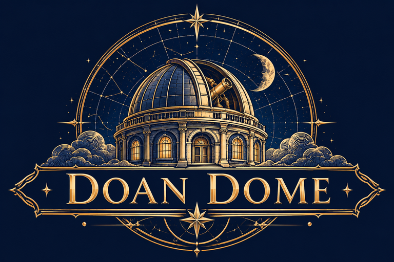

<p align="center">
  
</p>

# Doan Dome

A slideshow app for designing and presenting, set inside an old observatory. It opens beneath a closed dome. Open the shutter to a live night sky, choose **New presentation** or **Open presentation**, and the view tilts up into the stars while your presentation is prepared. Your library is a sky: every presentation is a constellation, with one star for each slide.

Part of the Doan suite, alongside Doan Excelsior (spreadsheets) and Doan Docs (documents). Built with React 19 and the React Compiler, with no UI framework and no backend.

> **Status: pass 1 of 4 (foundation).** The dome start screen, the constellation sky, branding, the slide editor (text, shapes, images), themes and presenting are done. See [Roadmap](#roadmap).

## Features

**The dome**
- The start screen is the observatory interior with the shutter closed. **Open the dome** slides the shutter up to reveal a twinkling sky with shooting stars.
- **New presentation** or **Open presentation** tilts the view up through the slot into the sky while the work happens, then the editor opens. The animation lasts as long as the work does, with a short minimum.
- **Skip to your sky** is always visible, a checkbox turns the intro off, and the account menu turns it back on or replays it. People with “reduce motion” set get simple fades.

**Your sky (the library)**
- Each presentation is a constellation: one star per slide, joined in slide order. Shapes are generated from the presentation, so each has its own recognisable pattern. The title slide is a gold star, and starred presentations wear a four-pointed star.
- Recently opened presentations shine brighter; older ones fade.
- Folders are **regions of the sky** (Work, Personal, Projects, School), labelled like an old star chart.
- Hover or Tab to a constellation to trace its lines and see a card with the first slide, slide count and last opened time. Click to zoom into it and open the editor.
- Shooting stars cross the sky every 10–20 seconds.
- Search dims every constellation that doesn’t match.
- A **Sky / List** switch shows the same presentations as a sortable table with Rename, Move, Duplicate, Star and Trash. Trash always uses the list.

**Slide editor**
- Slide strip with thumbnails: click to select, drag to reorder, or use each slide’s ⋯ menu (Duplicate, Move up/down, Delete) and Alt+↑/↓.
- Six layouts for new slides: Title slide, Title and text, Section header, Two columns, Title only, Blank.
- **Text boxes:** double-click (or Enter) to type. Font (Sans, Serif, Display), size, color, bold, italic, underline, alignment and vertical alignment.
- **Shapes:** rectangle, rounded rectangle, oval, triangle, diamond, star and arrow, with fill, outline color and outline width.
- **Images:** from your device, pasted, or dragged onto the slide. Large photos are scaled to 1600 px. Fill or Fit, and alt text.
- Drag to move (snapping to the slide’s edges and centre lines, hold Alt to skip snapping), corner and edge handles to resize (images keep their shape; hold Shift to change that), and a top handle to rotate (Shift for 15° steps).
- Exact position, size, rotation and opacity in the inspector. Bring to front, forward, backward, send to back.
- Keyboard: arrows nudge (Shift for 10), Delete removes, Ctrl+D duplicates, Ctrl+C/X/V copy, cut and paste (also between slides), Ctrl+A selects all, Ctrl+Z/Y undo and redo, Page Up/Down change slides.
- Undo and redo for everything; a whole drag is one undo step.
- Speaker notes under each slide.
- Slide size 16:9 or 4:3; switching rescales everything.
- Saves automatically.

**Slide themes**

| Theme | Look |
| ----- | ---- |
| Midnight | Indigo night with stars and a small gold constellation |
| Star Atlas | Parchment with a double gold border and compass roses |
| Nebula | Deep violet with pink and teal clouds |
| Clean | White, for everyday work |
| Graphite | Dark grey, for everyday work |
| Harbor | Pale blue with a navy edge band |
| Sunrise | Warm cream with an orange edge band |
| Area 51 | *Secret.* Green-on-black radar grid, TOP SECRET banners, a red CLASSIFIED stamp, redacted file line and a radar scope whose sweep turns while presenting. Typewriter font. Unlocked by catching every kind of UFO |

Text and shapes that don’t set their own color or font follow the theme, so switching theme restyles the whole presentation. Each slide can also have its own background color.

**Presenting**
- **Present** goes full screen from the first slide; the arrow beside it starts from the current slide.
- The first slide opens like the dome’s shutter, from a slit of light; later slides crossfade.
- Next: → Space Enter Page Down or click. Back: ← Backspace Page Up. Home and End. Type a number and Enter to jump. B for a black screen. W to make a wish: a shooting star streaks across the slide and bursts into a sparkle, for celebrating a big number (press it again for more). T for the telescope spotlight: the room goes dark except a gold eyepiece that follows the pointer (scroll or [ ] to resize). Esc ends the show.
- A small control bar appears when you move the mouse and hides when you stop.

**The real night sky**

**Explore the night sky** (top right of the Sky view) goes full screen and shows the real sky: all 88 constellations and every star down to magnitude 5, starting from roughly what's overhead where you are right now, with famous patterns like the Big Dipper picked out in brighter gold, over twinkling stars, shooting stars and the occasional meteor shower. Drag, scroll or use the arrow keys to look around, with Ctrl + scroll or + and − to zoom. The hint names the constellation you're facing, **Tonight** brings you back overhead, and Esc exits full screen back to your presentations.

**UFOs**

Now and then a UFO crosses the Sky view or the night sky explore view. There are three kinds, and clicking one sets off something different:

- **Flying saucer**: it hovers and beams up one of your presentations (or a real constellation), studies it and gives it back, then an agent in a black suit wipes your memory with a red beam and a white flash.
- **Tic tac**: it hangs still and jumps around, and dodges the pointer. Catch it and an infrared targeting camera locks on before it speeds away.
- **Space freighter**: a jump to lightspeed from its cockpit. While exploring, you drop out somewhere else in the sky.

The account menu can replay each one (**UFO abduction**, **Tic tac sighting**, **Jump to lightspeed**), switching to the Sky view if needed. Every UFO caught in the wild counts toward the sightings log in the menu, repeats included, along with how many of the 3 kinds you've found; menu replays don't count. Catching the last kind you're missing unlocks the secret **Area 51** slide theme, which then appears in every editor's theme picker (presentations already using it always show it). UFOs don't appear with reduced motion turned on. While developing, `ufo('saucer')`, `ufo('tictac')` or `ufo('freighter')` in the browser console summons one.

**App look**

The whole app uses one look, **Nebula**: deep violet with the logo’s gold. The header shows tonight’s real moon phase with a line about the night. Click it and the moon zooms up to fill the screen: how much is lit and how old it is, the next full moon with its folk name (Beaver Moon, Harvest Moon, Blue Moon and so on) and the next new moon, plus every full moon of the year. Click any of them (or use ← →) to preview it, each drawn in its own color (an orange Harvest Moon, a rosy Strawberry Moon, an icy Cold Moon); tonight stays highlighted in gold, and **Back to tonight** returns to it. The logo and dome artwork were recolored from navy to violet so they match.

**Files**

Presentations can be saved as and opened from **Doan Dome files (.dome)**, which hold everything including images. Use them for backups or to move a presentation between browsers.

**Download PowerPoint (.pptx) or PDF** from the editor’s download menu or a presentation’s ⋯ menu. PowerPoint files keep text, shapes, images and speaker notes editable, with the theme’s artwork as each slide’s background picture. PDFs have one page per slide, drawn exactly as in Doan Dome. Opening PowerPoint and PDF files is still to come.

## Getting started

You need Node.js 20.19 or later.

```bash
npm install
npm run dev
```

| Command           | What it does                                    |
| ----------------- | ----------------------------------------------- |
| `npm run dev`     | Starts the development server                   |
| `npm run build`   | Builds a static site into `dist/`               |
| `npm run preview` | Serves the build locally                        |
| `npm run lint`    | Checks the code, including the house style rules |

The app uses hash URLs (`#/home`, `#/deck/abc123`, `#/present/abc123/0`), so `dist/` works on any static host.

## Where presentations live

In this browser’s IndexedDB, which has room for images. There’s no account system or server, so presentations don’t sync between devices, and clearing site data deletes them; save a `.dome` copy of anything important. The sample presentations and collaborators are demo content. **Reset sample sky** in the account menu restores them.

## Artwork

The artwork is yours, in `docs/`. The app uses prepared copies:

| File | Made from | Used for |
| ---- | --------- | -------- |
| `src/assets/dome-open.webp` | `openobservatory.png`, with the black slot made transparent | The dome scene; the live starfield shows through the slot |
| `src/assets/dome-shutter.webp` | `observatoryInterior.png`, just the closed shutter | The strip that slides up when the dome opens |
| `src/assets/dome-slot-mask.png` | The slot’s shape | Clips the shutter so it only shows inside the slot |
| `src/assets/dome-closed.webp` | `observatoryInterior.png` | Kept for a future poster/fallback |
| `src/assets/logo-full.webp` | `DoanDome.png` | Welcome card on the dome |
| `src/assets/logo-emblem.webp` | The observatory from `DoanDome.png` | Header and editor |
| `public/icon-*.png`, `apple-touch-icon.png`, `favicon.ico` | The observatory on the logo’s navy | Browser tab, phone home screen, installed app |
| `public/logo.png` | `DoanDome.png`, smaller | README and sharing previews |

The logo’s background is a flat deep violet (#190134), so rather than cutting it out, the app’s header uses that exact color and the logo sits on it seamlessly.

The two dome pictures line up exactly, which is what makes the shutter animation possible: the open picture is the top layer with a hole where the sky is, the shutter strip sits behind it and slides up, and the starfield is behind both. If you replace either picture, keep the same size and framing, then regenerate the three dome files.

## Project structure

```
src/
├── main.jsx, App.jsx          Entry point and routing
├── styles.css                 The Nebula look and every style
├── pages/
│   ├── DomeIntro.jsx          The observatory start screen
│   ├── SkyPage.jsx            Sky and List views for every library page
│   ├── EditorPage.jsx         The slide editor
│   └── PresentPage.jsx        Full-screen presenting
├── editor/
│   ├── SlideCanvas.jsx        Selecting, dragging, resizing, rotating, text editing
│   ├── SlideStrip.jsx         Slide thumbnails and reordering
│   ├── Inspector.jsx          Theme, slide, text, shape, image and arrange settings
│   ├── useDeckEditor.js       Working copy with undo/redo and autosave
│   ├── ops.js                 Pure presentation edits
│   └── images.js              Scales pictures for slides
├── components/
│   ├── SlideView.jsx          Draws any slide at any size
│   ├── ConstellationSky.jsx   Presentations as constellations
│   ├── Starfield.jsx          Twinkling canvas sky with shooting stars
│   ├── DeckList.jsx, DeckActions.jsx   The List view and ⋯ menu
│   ├── AppShell.jsx, AppHeader.jsx, Sidebar.jsx, Logo.jsx
│   └── Menu.jsx, Dialog.jsx, Toast.jsx, EmptyState.jsx, Icon.jsx
├── hooks/                     useLibrary, useRoute, useOpenDeckFile, useDismiss
└── lib/
    ├── deckStore.js           Presentations, profile and settings
    ├── slideThemes.js         Slide themes and fonts
    ├── layouts.js             Slide layouts and sizes
    ├── shapes.js              Shape outlines
    ├── constellations.js      Star positions and brightness
    ├── skyChart.json          The real sky: constellation figures, names and stars (d3-celestial)
    ├── deckFile.js            .dome files
    ├── exportDeck.jsx         PowerPoint and PDF export (loaded on first use)
    ├── storage.js             IndexedDB
    └── router.js, random.js, dates.js, folders.js, toastStore.js
```

## How it works

**One renderer.** `SlideView` lays a slide out in slide units (1920 × 1080 for 16:9) and scales it with a single CSS transform, so thumbnails, the editor, the hover cards and the full-screen show are pixel-for-pixel the same.

**Editing on top.** The editor draws the slide with `SlideView`, then places invisible hit boxes over each element for selecting and dragging, plus handles for resizing and rotating. Every edit is a pure function in `ops.js` that returns a new copy; `useDeckEditor` keeps those copies for undo, merges quick runs of the same change into one step, and saves half a second after you stop.

**Constellations.** Each presentation’s id seeds a random walk with one step per slide, so the shape is stable and unique. Opening one zooms the sky toward that constellation before the editor appears.

**The dome.** Three stacked layers: the canvas starfield, the shutter strip clipped to the slot, and the open-dome picture with the slot cut out. Opening slides the shutter up; choosing an option scales the whole scene up through the slot.

## Code style

- Every function is a `const` arrow function, including components. ESLint fails on the `function` keyword.
- No `useMemo`, `useCallback` or `React.memo`: the React Compiler handles memoization.
- One component per file, plain JavaScript with JSX, no CSS framework.

## React 19 features used

| Feature | Where |
| ------- | ----- |
| React Compiler | Whole app |
| `useActionState` + transitions | Dome intro, opening .dome files |
| `useEffectEvent` | Presenting keys, pasting images, autosave on leave |
| `useSyncExternalStore` | Library, router, toasts |
| `useReducer` | Editor history |
| `<title>` in components | Every page sets the tab title |
| `inert` | Hides the dome’s choices until the shutter is open |

## Accessibility

Keyboard access throughout (including Tab and Enter for constellations and every editor action), visible focus rings, labelled icon buttons, menus with arrow keys, native `<dialog>` modals, live regions for save status and slide changes, the List view as a fully accessible alternative to the Sky, and reduced-motion support everywhere.

## Roadmap

1. **Foundation (this release):** dome, sky, branding, editor for text, shapes and images, themes, presenting.
2. **Rich content:** tables, charts, lines and video; templates for everyday use; presenter view with notes, timer and next slide.
3. **Motion:** transitions including morph, and per-item animations (fly in, fade, grow, spin, exit) in an order you set.
4. **Files:** open PowerPoint (.pptx) files. (Saving as PowerPoint and PDF is done.)

Also planned: per-word formatting inside text boxes, and your remaining artwork (zodiac ornaments, slide backgrounds) as it arrives.

## Licensing

React and Vite are MIT. Fonts are under the SIL Open Font License. pptxgenjs and html-to-image are MIT; jsPDF is MIT. The star chart in `src/lib/skyChart.json` comes from [d3-celestial](https://github.com/ofrohn/d3-celestial), Copyright (c) 2015, Olaf Frohn, under the BSD 3-Clause license. The artwork in `docs/` and `src/assets/` is yours. Choose a license for your own code.
